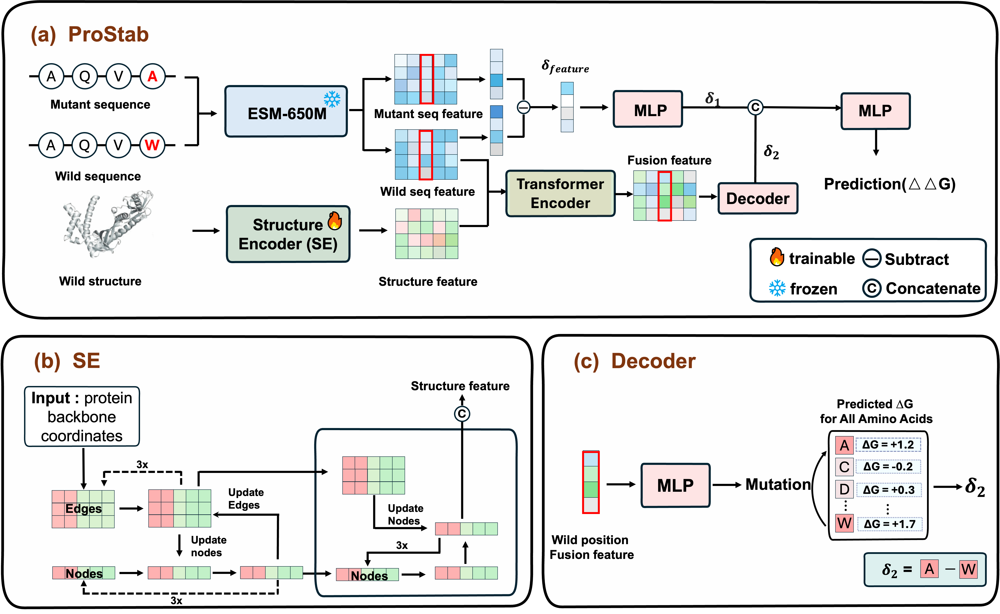

<h1 align="center">ProStab</h1>

<p align="center">
  <strong>Protein stability prediction with inverse folding and protein language models</strong>
</p>

<p align="center">
  <a href="https://pytorch.org/"></a>
  <a href="https://lightning.ai/"></a>
  <a href="https://www.biorxiv.org/content/10.1101/2025.08.11.669595v1"></a>
  <a href="https://github.com/facebookresearch/hydra"></a>
</p>

<p align="center">
  <a href="https://ails.sjtu.edu.cn/prostab/"><strong>Web server</strong></a> ·
  <a href="https://www.biorxiv.org/content/10.1101/2025.08.11.669595v1">Paper</a> ·
  <a href="#quick-start">Quick start</a> ·
  <a href="#python-api">Python API</a> ·
  <a href="#citation">Citation</a>
</p>

Predict stability changes (ΔΔG) for **single amino-acid substitutions** from a
wild-type PDB structure using ProteinMPNN and ESM2.

<p align="center">
  
</p>

For multiple substitutions and insertions/deletions, see [UniStab](https://github.com/xlab-BioAI/UniStab).

## Quick start

Linux · Python 3.7.12 · PyTorch 1.13.1 · CUDA or CPU

```bash
git clone https://github.com/xtanh/ProStab.git
cd ProStab
conda env create -f environment.yml
conda activate ProStab
```

### Weights

Download the two checkpoints to these locations:

| Checkpoint | Destination |
| --- | --- |
| [ProStab](https://drive.google.com/file/d/1xZOG3wkn6UGJS_j533laRbZLWV5DU13T/view) | `model_weight/checkpoints/best.ckpt` |
| [ProteinMPNN](https://github.com/dauparas/ProteinMPNN/blob/main/vanilla_model_weights/v_48_020.pt) | `data/checkpoints/ThermoMPNN/vanilla_model_weights/v_48_020.pt` |

The matching ProStab configuration is included in `model_weight/.hydra/config.yaml`.
ESM2 downloads automatically on first use and caches its weights in
`~/.cache/torch/hub/checkpoints/` (configurable with `TORCH_HOME`).

### Predict

```bash
prostab predict --model-dir model_weight \
  --pdb data/inference_example/1A0N.pdb --chain A --mutation V1A
```

The command returns JSON with the predicted `ddg` (approximately `0.1232584` for
this example). **Negative ΔΔG predicts increased stability; positive predicts
decreased stability**, in kcal/mol.

Use original PDB residue numbers: `V1A` replaces valine at residue 1 with alanine;
`G42AS` replaces glycine at residue 42A (insertion code A) with serine. The selected
chain and wild-type amino acid must match the structure, with complete N, CA, C
and O coordinates at the mutation site. Chain IDs are case-sensitive; use `" "`
for a blank chain ID. Negative residue numbers are supported.

`--device auto` selects CUDA when available. Set `--device cpu` or `--device cuda:N`
to choose a device.

## Batch predictions

```bash
prostab predict-batch --model-dir model_weight \
  --input examples/mutations.csv --output predictions.csv
```

Each CSV row is an independent single substitution:

```csv
pdb_path,chain,mutation
../data/inference_example/1A0N.pdb,A,V1A
../data/inference_example/1A0N.pdb,A,P57A
```

PDB paths are relative to the input CSV. Results retain row order and add
`ddg,status,error`. Failed rows have an empty `ddg`; other rows continue. The exit
code is 1 if any row fails, otherwise 0. Choose a new output filename for each run.

## Python API

```python
from prostab import Predictor

predictor = Predictor("model_weight")
pdb = "data/inference_example/1A0N.pdb"

score = predictor.predict(pdb, "A", "V1A")
results = predictor.predict_many(pdb, "A", ["V1A", "P57A"])
```

`predict` returns a float and raises on invalid input. `predict_many` returns
ordered records with `ddg,status,error`; failed predictions have `ddg=None`.
See [inference.ipynb](inference.ipynb) for an interactive example.

<details>
<summary>Custom paths and offline use</summary>

`--model-dir` selects the directory containing `.hydra/config.yaml` and
`checkpoints/best.ckpt`. Use `--mpnn-weights` and `--esm-weights` for local auxiliary
weights; keep `esm2_t33_650M_UR50D-contact-regression.pt` beside the ESM2 model file.
The Python equivalents are `model_dir=`, `mpnn_weights=` and `esm_weights=`.

```bash
prostab predict --model-dir /path/to/model_weight \
  --mpnn-weights /path/to/v_48_020.pt \
  --esm-weights /path/to/esm2_t33_650M_UR50D.pt \
  --pdb /path/to/structure.pdb --chain A --mutation V1A
```

</details>

## Development

```bash
python -m pip install -e '.[dev]'
python -m pytest -m 'not integration'
# With local weights prepared:
PROSTAB_RUN_INTEGRATION=1 python -m pytest -m integration
```

Training and evaluation use `train.py` and `test.py`, the original datasets and
`pip install -e '.[train]'` (pip 23.3.2). The historical environment is saved in
[configs/environment-legacy.yml](configs/environment-legacy.yml).

## Acknowledgments

The training and evaluation pipelines, datasets, configurations, baselines and
metrics are adapted from [SPURS](https://github.com/luo-group/SPURS).
We thank its authors for their code, data and guidance. ProStab also builds on
[ProMEP](https://github.com/wenjiegroup/ProMEP),
[ESM](https://github.com/facebookresearch/esm) and
[ProteinMPNN](https://github.com/dauparas/ProteinMPNN).
See the [SPURS license](https://github.com/luo-group/SPURS) for the underlying framework.

<a id="citation"></a>

## Citation

If you use ProStab, please cite ProStab and SPURS. Full citations for these and the
other foundational methods are in [references.bib](references.bib).

```bibtex
@article{prostab2025,
  title={ProStab: Prediction of protein stability change upon mutations by inverse folding and protein language models},
  author={Tan, Hong and Wei, Xiaowei and Lin, Shenggeng and Mao, Xueying and Chen, Junwei and Sun, Heqi and Zhang, Yufang and Zhou, Zhenghong and Wei, Dong-Qing and Lin, Shuangjun and Xiong, Yi},
  journal={bioRxiv},
  year={2025},
  doi={10.1101/2025.08.11.669595},
  url={https://doi.org/10.1101/2025.08.11.669595}
}
```
